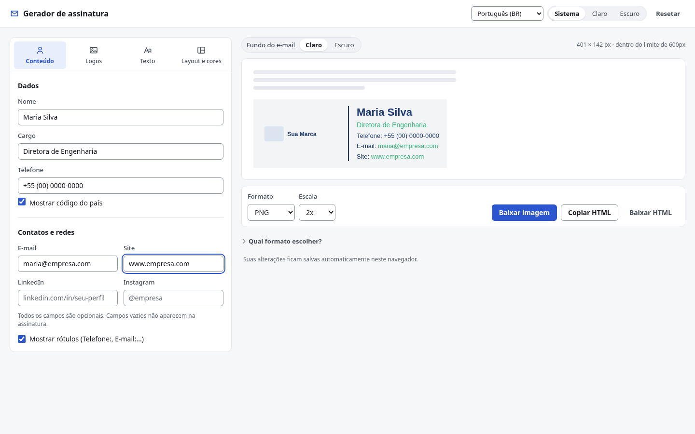

# Email Signature Generator



A browser-based tool to design, preview, and export email signatures with custom colors, logos, fonts, and layout.

## Features

- Live preview of the signature as you edit, always visible: a sticky column on desktop, pinned at the top on phones
- Editor organized in tabs (Content, Logos, Text, Layout & colors) with fine-tuning tucked under "Fine-tune"
- Preview inside an email frame with light or dark email background, plus a size readout that warns above the recommended 600px width
- Defaults follow email signature guidance (22px name, 13–14px details, about 400px wide)
- Optional text lines: name, role, phone, email, website, LinkedIn and Instagram; empty lines are hidden
- Contact lines become links (`tel:`, `mailto:`, `https:`), with optional labels ("Phone:", "Email:"...)
- Per-line text style: size, weight, own color, italic, uppercase, letter spacing, line height, space above and indent
- Layout: logos left, right or above the text; text alignment; outer margins
- Divider: show/hide, solid/dashed/dotted, thickness, length that follows the content or is fixed, and spacing on each side (becomes horizontal when logos are above the text)
- Custom colors: text, divider, accent (role and links) and background, each labeled with where it is used
- Built-in color palettes for quick styling
- Font family selector (Arial, Trebuchet MS, Segoe UI, Verdana, Tahoma, Georgia, Times New Roman)
- Logo upload via file picker or drag-and-drop (main and secondary), side by side or stacked
- Logo editor, per logo:
  - occupied area (width and height) separate from the logo size, with "fit area to logo"
  - fit mode (show whole logo or fill the area), size (zoom), 9-point alignment and horizontal/vertical nudge
  - interactive crop (free, match area, 1:1, 4:3, 16:9) powered by [Cropper.js](https://github.com/fengyuanchen/cropperjs), loaded only when used
  - adjustments are baked into a fixed-size PNG, so exported images and HTML look the same in every email client (see `docs/adr/0002-bake-logo-adjustments-into-exported-image.md`)
- Image export: PNG, JPG, WebP and SVG, with 1x/2x/3x scale and quality control for JPG/WebP; the status shows the file size
- Guided "Copy HTML" flow: asks which email client you use and whether your logo is hosted at a public https URL, tests the URL, copies rich HTML and shows paste instructions; without a hosted logo it recommends image export instead
- Download signature as standalone HTML file
- Internationalization: English and Portuguese (Brazilian), auto-detected from the browser (falls back to pt-BR)
- Autosave: the signature, logos and export settings are kept in the browser (localStorage) and restored on reload; reset asks for confirmation and clears them. If logos are too large to store, everything else is still saved and a message explains it
- Light and dark site theme: follows the system by default, with a System / Light / Dark switch that is remembered. The signature itself keeps its own colors

## Usage

1. Fill in your name, role, and phone number
2. Pick a font family
3. Upload logos (optional) and choose layout
4. Adjust colors manually or pick a palette
5. Preview updates in real time
6. Export as PNG, JPG, WebP or SVG, or copy/download the HTML

## Development

Requirements: Node.js (version in `.nvmrc`) and npm.

```bash
npm install
npm run dev
```

Then open the URL printed by Vite (usually http://localhost:5173).

### Checks

| Command | What it does |
|---|---|
| `npm run typecheck` | Strict TypeScript check |
| `npm run test` | Unit tests (Vitest) |
| `npm run build` | Production build into `dist/` |
| `npm run test:e2e` | End-to-end tests (Playwright) against the built app |
| `npm run check` | All of the above, in order |

Before the first end-to-end run, install the browser once:

```bash
npx playwright install chromium
```

### Agent skills

Project skills live in `.agents/skills/` (linked into `.claude/skills/` for Claude Code) and are pinned in `skills-lock.json`. They are committed, so a fresh clone already has them. To restore or reinstall them from the lock file:

```bash
npx skills experimental_install
```

### Deployment

The GitHub Actions workflow (`.github/workflows/deploy.yaml`) runs the full check on every pull request and push. Pushes to `main` publish `dist/` to GitHub Pages.

Architecture decisions are recorded in `docs/adr/`. The interface follows `docs/design-system.md` (research, tokens, components and checklist), with before/after captures in `docs/design/`.

## Tech Stack

- TypeScript and plain DOM (no UI framework), built with [Vite](https://vite.dev)
- [html-to-image](https://github.com/bubkoo/html-to-image) for image export
- [Cropper.js](https://github.com/fengyuanchen/cropperjs) for logo cropping
- [Vitest](https://vitest.dev) and [Playwright](https://playwright.dev) for tests
- Static output, deployed to GitHub Pages
